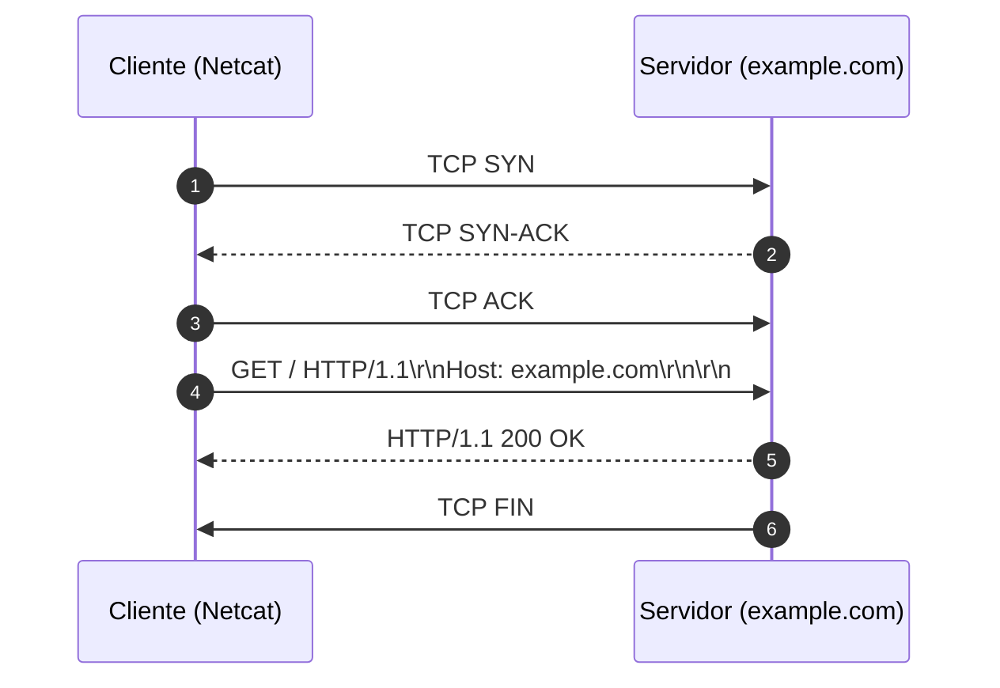

# Memória de Desenvolvimento — Semana 01
**Aluno:** Yasmim Barcelos Rangel  
**Curso:** Engenharia da Computação  

---

## 1. Mapeamento da Camada de Transporte
Diagrama Mermaid demonstrando o ciclo de vida da requisição executada no laboratório:

---

## 2. Captura Bruta e Análise do Protocolo
* **Comando Utilizado:** `nc -C example.com 80`
* **Status Line Retornada:** `HTTP/1.1 200 OK`

### Análise dos Headers Recebidos:
1. **`Content-Type`:** Serve como uma instrução de leitura, o Content-type avisa ao receptor que tipo de dado está sendo enviado por meio de um identificador padronizado chamado MIME type, que diz qual parser correto utilizar para a execução.
2. **`Content-Length`:** Como o protocolo TCP transmite dados como um fluxo contínuo de texto, o Content-Length serve como uma régua: ele diz ao receptor exatamente quantos bytes ler após os cabeçalhos (\r\n\r\n) para saber onde o corpo termina e onde a próxima requisição/resposta começa no mesmo socket.
3. **`Connection: close`:** Na realização do exemplo por netcat, estabelecemos uma conexão TCP. Onde assim que o requisito é enviado para o servidor, ele executa e envia a resposta, encerrando a conexão logo após. Para fazer que a conexão continue esperando por outras mensagens, é necessário mudar o "Connection: close" para "Connection: keep-alive"

---

## 3. Conclusão Técnica
O HTTP opera sobre uma conexão TCP sem fronteira de dados nativos. Então a leitura se baseia em um fluxo continuo de bytes ASCII e não um arquivo estático.  Enquanto um arquivo local possui um limite fixo no disco, no HTTP o término de cada mensagem é sinalizado sintaticamente no fluxo por delimitadores como CRLF (\r\n\r\n) ou pelo cabeçalho Content-Length. Entender essa diferença é o que possibilita ao desenvolvedor gerenciar conexões abertas (keep-alive), tratar dados dinâmicos em tempo real e interpretar a transmissão real do protocolo na rede.
